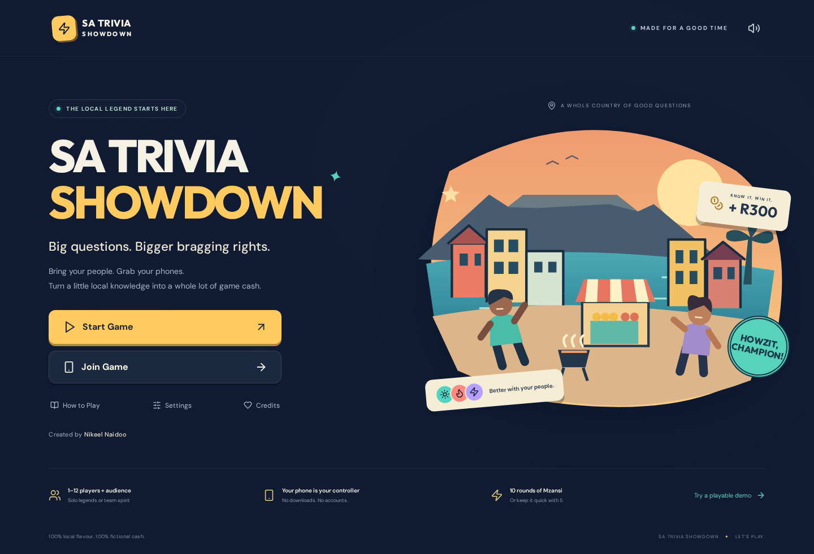

# SA Trivia Showdown

**Created by Nikeel Naidoo — creator and concept owner.**

A colourful, original South African party game for a shared TV and phone controllers. Compete for fictional game cash with trivia, map and rhythm duels, cards and short surprise events. The show now uses layered 3D-style depth and TV-sized typography. There are no purchases, real-money stakes or cash-outs.

**[Play SA Trivia Showdown](https://nikeelnaidoo5518.github.io/sa-trivia-showdown/)** — choose **Start Game** for a TV room and phone controllers, or **Try a playable demo** for bots and an on-screen controller. Open **TV view** for bigger text and remote-control navigation. The Pages workflow includes the public web configuration for the game’s Firebase project.



## Play locally in two minutes

Requires Node.js **24 LTS** and npm.

```sh
npm ci
npm run dev
```

Open `http://localhost:5173`. Choose **Try a playable demo** to play with three bots and an on-screen phone. Use the phone icon in the header to minimise or reopen the demo controller. The demo runs without Firebase, accounts or internet after installation.

For actual phones on the same Wi-Fi, open the **Network URL** printed by Vite on the host computer, e.g. `http://192.168.1.23:5173`, then select **Start Game**. Scan the QR code or enter the code through **Join Game**. Allow local ports **5173 and 3001** through the computer's firewall. Opening the host on `localhost` produces a localhost QR link, which a different device cannot use. The local WebSocket relay is for trusted local networks and development; it is not the GitHub Pages backend.

To preview the production build:

```sh
npm run build
npm run preview
```

Without Firebase configuration, production builds use browser-local demo transport. Demo rooms share state only between tabs of the same browser and origin. For separate devices on GitHub Pages, configure Firebase below.

## What is playable

- Start, Join, How to Play, Settings, dedicated Credits, and post-match End Credits.
- 1–12 competing players and audience participants, up to 40 room members total.
- Solo and two-team modes. Teams use average cash so a larger team does not automatically win.
- Choose 5, 10, 15 or 20 rounds in the pre-game screen. Standard rounds keep the familiar Warm-Up, Pick Your Province, Picture This, Mzansi Map Sprint, Sound It Out, Case Crackers, Team Huddle, Braai Battle, Mzansi Mix and Final Showdown lineup. Trivia rounds ask five questions from one announced category; map rounds have five location challenges, with mini-game breaks between them. The seven-question Final Showdown stays last.
- Five-round Quick Match: Warm-Up (5), Picture This (5), Map Sprint (5), Braai Battle (one mini-game), Final Showdown (7).
- Solo and team play both get five questions in each trivia round. In Team Huddle, teammates discuss each question and submit one shared team answer. Majority wins; tied votes use the earliest submission.
- Final Showdown is a longer cash-climb finale: its seven same-category questions rise from R300 to R900 base rewards. Players lock one secret wager on the seventh question.
- Case Crackers replaces the old wager-only round. Players wager secretly before each of five questions, then choose an answer case on their phones. The TV opens the cases after answers lock, showing the correct answer and decoy traps. Wrong answers lose only the wager; wagers are capped at R300.
- Six one-use cards: Steal, Cash Shield, Extra Hint, Double Down, Robot Repair, Power Backup. Each opens an effect/confirmation dialog before use.
- Six optional events: Load-shedding, Broken Robots, Municipal Mayhem, Taxi Detour, Mystery Envelope, Cash-in-Transit Chaos. Events occur after every completed round, except the final. The event is chosen without repeating until its pool is exhausted.
- Map, Braai and Drum Beat duels in longer matches; Robot Repair and catch-and-answer challenges in events; Robot Repair, Drum Beat, Picture Puzzle and Goal Rush in the **How to Play → bonus arcade**. Drum Beat gives each tap an original synthesized tone. Arcade practice does not alter match scores.
- Audience answers and duel-winner predictions, round results, team/player standings, winner/tie celebration, Most Correct, Best Duel, Biggest Comeback, Play Again.
- Three original animated mascots travel through the menu, lobby, round intros, answer reveals and winner screen: Zola the Quiz Bot, Pip the Rhythm Bird and Sizzle the Braai Buddy. Quick stage fades, case-opening reveals and winner reactions honour the reduced-animation setting and the browser’s reduced-motion preference.
- Original SVG scenery and artwork, self-hosted fonts, high-contrast controls, written audio fallbacks, keyboard input, larger text and optional vibration.

## Interactive party update

- Start Game and the demo open a keyboard-accessible Easy / Medium / Hard / Mixed difficulty picker before room creation. Each trivia round announces its category, keeps that category for all five questions, and shows question progress on the TV and phone.
- Once all competing players answer, the host reveals results automatically after a 1.5-second confirmation interval. Otherwise the normal timer or host reveal control ends the question. Pausing suspends automatic reveal. The TV and phones display round winners, the correct answer and cash changes.
- **Automatic round flow** is enabled by default: tutorials begin after six seconds and result screens move on after eight seconds. The host can pause the countdown, continue early, or turn automatic flow off in Settings.
- Each competitor has two **Confetti Jam** tricks per match. During a round tutorial, choose a rival and confirm. One trick may be used per player per round; teams can target only opponents. The target clears three bursts or waits up to five seconds after play starts. A Cash Shield blocks the trick. These are original game mechanics and visuals.
- A quiet, original four-bar synth theme loops on the host display during play, with synthesized stings for the lobby, question, vote, wager, duels, events, answers and winner. Drum taps play short notes on the phone. Browser autoplay rules mean audio begins after the first tap or remote key press. The volume button and Settings sound switch control the music, effects and spoken clues together.
- **TV view** enlarges the host layout, adds stronger stage depth, and lets a TV remote's arrow keys move focus between controls. The remote's select/OK button activates the focused control. Phones continue to join as browser controllers.
- The site includes a web-app manifest and a small cached shell for compatible browsers. On a supported browser, add SA Trivia Showdown to the home screen and launch directly into TV view. TV browser support varies by model and operating system; this repository does not yet contain a signed Fire TV, Android TV, Samsung Tizen or LG webOS store package.
- Memory-only challenges have been removed from the playable flow. Braai and repair codes remain visible while players follow them; Mystery Envelope is now catch-and-answer. Bonus Market Memory was removed from the menu. Optional mini-game events now appear between every round.
- Final Showdown now has a seven-step reward ladder, rising mixed-difficulty questions and a final secret wager. The live ladder shows the current reward on the TV and phones.

## Controls and scoring

The host can let tutorials and result screens advance automatically, continue early, or pause and resume the countdown. During a timed activity the host can **Pause**, **Resume**, **Skip**, or **End game**. Skipping changes no cash. End game goes to current final scores, then credits. Automatic progression can be disabled in Settings. The host can start with unready players if necessary.

Phone buttons only submit the current activity. A confirmation appears after input is accepted. A locked answer or wager cannot be changed. Players receive R500 starting cash. Ordinary correct trivia earns R300; Final Showdown rewards climb from R300 to R900. Individual correct trivia answers earn a small speed bonus of up to R30, based on host-received submission time. Team Huddle and audience answers do not earn speed bonuses. Case Crackers wagers are capped at R300 and the final wager at R500, both capped by current cash. A wrong case pick loses only the wager; other wrong answers lose the wager, plus R100 if Double Down was used. A correct Double Down adds R200. Balances cannot fall below zero.

Map Sprint awards R300 within 8 schematic map units, R200 within 16, R75 within 25. Braai Battle awards R40 per correct position and R60 for a perfect sequence. Predictions reward R50 for a winning player, including tied duel winners. Audience participants earn R50 for a correct selected activity; their cash does not enter competitive standings. Robot Repair adds R100 to the round ledger. A steal takes at most R100 from the leading opponent, and a shield blocks one steal or event loss. The highest event loss is R50.

Phone map controls: tap the map, then **Lock my pin**. Keyboard users focus the map, move with arrow keys, press Enter to place the pin, then activate the lock button. Ordering challenges use buttons in the chosen order; Reset allows changes before submission. Spoken clues play only after a tap and when sound is enabled.

## Firebase for internet multiplayer

Firebase's free Spark plan can support small personal game nights within its quotas. Check current Firebase pricing and quotas before larger events. No Cloud Functions or service-account key is needed for this version.

The hosted game uses project `sa-trivia-showdown-5518-f09c4`, with anonymous authentication and a Realtime Database in `europe-west1`. Its access rules and authentication configuration are deployed. `.firebaserc` selects this project for CLI commands. The Pages workflow contains only public client configuration, not login tokens or administrative credentials. For a fork, configure your own project and override all five workflow variables below.

1. Create a Firebase project at <https://console.firebase.google.com/>.
2. Add a **Web app** and copy its public web configuration.
3. Under **Authentication → Sign-in method**, enable **Anonymous**. Players never see a login or create an account; the SDK keeps an anonymous session for reconnection.
4. Under **Realtime Database**, create a database in a suitable region. Use locked/production mode. Copy the exact database URL; regional URLs may end in `firebasedatabase.app`.
5. Paste `database.rules.json` into **Realtime Database → Rules** and publish. Do not use public read/write rules. Alternatively, with your own Firebase CLI login:

   ```sh
   npx firebase login
   npx firebase use --add
   npx firebase deploy --only database
   ```

6. Add `localhost` and your Pages hostname (e.g. `nikeelnaidoo5518.github.io`) to **Authentication → Settings → Authorized domains** if your project requires them. Do not add a URL path.
7. Copy `.env.example` to `.env.local` and fill these variables:

   | Variable                     | Firebase web configuration field |
   | ---------------------------- | -------------------------------- |
   | `VITE_FIREBASE_API_KEY`      | `apiKey`                         |
   | `VITE_FIREBASE_AUTH_DOMAIN`  | `authDomain`                     |
   | `VITE_FIREBASE_DATABASE_URL` | `databaseURL`                    |
   | `VITE_FIREBASE_PROJECT_ID`   | `projectId`                      |
   | `VITE_FIREBASE_APP_ID`       | `appId`                          |

8. Restart the dev server. **Start Game** now uses Firebase automatically; **Try a playable demo** still uses demo transport. Test with separate browsers before inviting the room.

These web configuration values are public client identifiers and are included in the built JavaScript. Access is protected by Firebase Authentication and database rules. **Never put an Admin SDK key, service account, private key, GitHub token or other secret in a `VITE_` variable or in Git.** `.env.local` is ignored. Firebase App Check and a cleanup function can be added for a large public release.

### Multiplayer design and reconnection

The TV is the authoritative host. It selects questions, validates submissions, keeps the private answer/wager ledger, controls timers and computes scores. Firebase transports room snapshots and private per-user inputs. Players can write only their own membership and input paths; only the host can update public game state. An input is readable only by its player and host. Public snapshots contain submission counts, never submitted answers or secret wagers.

The browser stores its anonymous Firebase session (or local relay identity), nickname/profile, host checkpoint and the 200 most recently seen question IDs. Reopen the same URL in the same browser to restore a phone. If connectivity drops, tap **Reconnect**. To recover the TV after refresh, use **Resume your last hosted room** on the menu. Keep the TV browser open and awake during play. Clearing browser storage or changing browser/device creates a new identity; name-only recovery is deliberately not allowed. Host migration to another device is not implemented.

Rooms expire for players after 12 hours. Expiration denies access but does not automatically delete database records. A project owner can remove old `rooms` entries from the Firebase console; use scheduled cleanup before running this as a high-volume public service.

The local relay verifies separate per-session reconnect tokens and sends private inputs only to the host. Restarting the relay removes its in-memory rooms; the host can resume its saved checkpoint to recreate a room.

## GitHub repository and Pages deployment

The source, tests and deployment workflow are published at **[nikeelnaidoo5518/sa-trivia-showdown](https://github.com/nikeelnaidoo5518/sa-trivia-showdown)**. Clone the existing repository to work on it:

```sh
git clone https://github.com/nikeelnaidoo5518/sa-trivia-showdown.git
cd sa-trivia-showdown
npm ci
```

Pages is configured to deploy through GitHub Actions. A repository administrator can manage Pages settings and add the public Firebase configuration under Actions variables. No private credentials are needed in the repository.

1. In GitHub **Settings → Pages → Build and deployment**, select **GitHub Actions**.
2. Under **Settings → Secrets and variables → Actions → Variables**, add the five public `VITE_FIREBASE_*` values above. When unset, this repository’s workflow uses the hosted game’s public Firebase configuration. Local builds without `.env.local` still use demo transport.
3. Push to `main`, or run **Test and deploy GitHub Pages** manually from Actions.
4. The workflow installs dependencies, validates the full question bank, runs engine tests, browser tests and Firebase emulator tests, builds `dist`, then deploys it to Pages. PRs run checks without deploying.
5. The live URL is <https://nikeelnaidoo5518.github.io/sa-trivia-showdown/>. The demo was checked on this public URL on 24 October 2026, including a full Quick Match, scoring, end credits and the mobile join page. Live Firebase room creation, joining from an independent browser, answer delivery and host/phone reconnection were also verified.

Vite uses relative asset URLs and joining uses query parameters, so repository subpaths and QR links work without SPA rewrite rules. Firebase rules must be published separately; the Pages workflow never receives Firebase admin credentials.

## Question library

`src/data/questions-a.json`, `questions-b.json`, and `questions-c.json` contain **629 questions** across ten categories. Every category has at least 60 questions. The bank has 554 multiple-choice, 12 true/false, 6 image clues, 10 spoken audio clues, 10 map questions, 12 short answers, 8 scrambles, 9 ordering and 8 matching questions. Matching questions ask players to identify the correctly matched pair. The new KZN additions cover Durban and Pietermaritzburg as well as South African Indian history, festivals, languages, food and cultural heritage.

Every entry includes ID, category, difficulty, region, age suitability, format, answer, an interesting fact, and a source title, URL and verification note. Explicit accepted variants are supported. Text grading ignores case, punctuation, whitespace and diacritics; it does not use an AI judge. Original arithmetic/word puzzles have self-contained premises and notes rather than fabricated historical claims. Images are stylised original clue illustrations, not portraits or photographic identification. Audio uses original spoken clues rather than copyrighted tracks.

Question IDs cannot repeat within a match. Selection avoids the most recent 200 IDs when alternatives exist, respects selected categories and family filtering, and prefers the selected difficulty. Each trivia set locks one category for all its questions. Special rounds prefer their format; the warm-up prefers an accessible question. A format/difficulty falls back within the selected eligible pool if unavailable. The five-question Mzansi Mix rotates short/scramble, ordering/matching, then choice formats where that category has them. Map Sprint uses the dedicated ten-city schematic bank independently of category selection.

Some factual references were checked from web excerpts; others cite stable reference material. Source notes record the distinction. This is an editorial first edition, not an independently fact-checked educational publication. Report ambiguous questions by ID; revise wording or add accepted variants rather than guessing an answer.

## Tests

```sh
npm run validate       # all 629 entries, categories, formats, options, sources
npm test               # engine, scoring, rounds, cards, events, privacy, reconnect
npx playwright install --with-deps chromium
npm run test:e2e        # real browser TV + independent phone sessions and local relay
npm run test:firebase   # Java 21+; auth/database emulator, rules and browser integration
npm run build          # production bundle
```

Stop an existing dev server before browser tests; the suites start and stop their own servers on ports 5173/3001 and 5174. Local-relay tests explicitly disable Firebase configuration so they cannot touch a real project.

Tests cover QR decoding and following the decoded URL, manual joining, ten-round completion, final credits, quick-match settings, screen sizes 1920×1080, 1440×900, 390×844, 360×800 and 320×568, pause/resume, reconnect after refresh, privacy, wager caps, cards, six events, solo/team scoring and question uniqueness. Automated QR decoding does not substitute for checking a physical phone camera on the actual TV. See `TESTING.md` for measured results and remaining deployment checks.

## Project map

| Path                           | Purpose                                           |
| ------------------------------ | ------------------------------------------------- |
| `src/main.jsx`                 | Menus, lobby, TV views, phone controller, credits |
| `src/engine.js`                | Authoritative match state machine and scoring     |
| `src/transport.js`             | Firebase, local relay and browser demo transports |
| `src/components/Art.jsx`       | Original SVG scenes and shared symbols            |
| `src/components/MiniGames.jsx` | Map, visible recipe and arcade controls           |
| `src/data/`                    | Structured question bank                          |
| `server/local.mjs`             | Development WebSocket relay                       |
| `database.rules.json`          | Firebase access rules                             |
| `.github/workflows/pages.yml`  | Checks and GitHub Pages deployment                |
| `android/`                     | Landscape Android TV / Google TV / Fire TV wrapper |

## TV app options

### Android TV / Google TV / Fire TV APK

**[Download the latest SA Trivia Showdown TV APK](https://github.com/nikeelnaidoo5518/sa-trivia-showdown/releases/latest/download/SA-Trivia-Showdown-TV.apk)** · [See all releases](https://github.com/nikeelnaidoo5518/sa-trivia-showdown/releases)

The landscape APK opens the hosted game directly in TV view, supports a TV remote's arrow and select buttons, hides phone-only system chrome, and keeps the screen awake while playing. It needs an internet connection; the APK is a lightweight TV launcher for the live game, not an offline copy. Phone players still join by scanning the TV's QR code or entering its room code in their phone browser.

To install, download the APK on an Android/Google TV or Fire TV device and open it, or transfer it from a computer with Android TV's **Install unknown apps** option enabled. The exact menu name varies by device. This sideload package is not a Play Store or Amazon Appstore submission. It is not compatible with Samsung Tizen or LG webOS. No APK signing key is stored in this repository; the GitHub build creates a standard sideloadable debug-signed package.

The Android TV project is in `android/`. To build it locally, install JDK 17, Gradle 8.9, and Android SDK platform 35/build tools, then run `gradle -p android assembleDebug`; the APK is written to `android/app/build/outputs/apk/debug/app-debug.apk`. The **Build Android TV APK** GitHub Actions workflow builds and publishes a versioned release on changes to `android/`, or when run manually from the repository's Actions page. The stable download link above always targets the latest release asset.

The same hosted app can still be opened in a TV browser at `https://nikeelnaidoo5518.github.io/sa-trivia-showdown/?tv=1`. Samsung and LG require their own Tizen and webOS packages and store review. Keep the TV device online and signed in during play.

## First-version limits

- The hosted game uses Firebase’s free Spark plan. Availability and player capacity remain subject to the project’s quotas; no paid plan was enabled.
- The Android TV APK is a sideload build, not a store submission. Actual remote behavior, sound and screen overscan still need a check on the target TV model. Samsung/LG store packages have not been built.
- Host authority and the publicly bundled question bank suit friendly in-room games. This is not a cheat-proof competitive platform. A determined developer can inspect the question bundle; hardening requires server-side question delivery and scoring.
- One host, two fixed teams, one shared display. No account system, matchmaking, chat, host transfer, remote video or persistent global leaderboard.
- Map geometry is deliberately schematic. Speech quality depends on the browser/device's available voice; text always remains available.
- Drum Beat, Picture Puzzle and Goal Rush are bonus practice games, not extra rounds inside the standard match.
- Nine optional event slots appear in a standard match; events are selected without repeating until all six have appeared.
- Browser automation was run in Chromium. Safari/iOS audio, physical QR scanning and real TV overscan need hardware checks before a large event.

See `THIRD_PARTY.md` for software/font credits. Creator credit is displayed on the start menu, dedicated Credits page, and End Credits.
